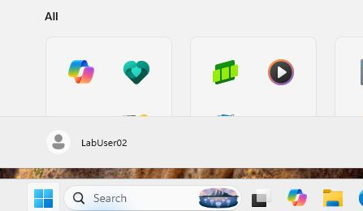
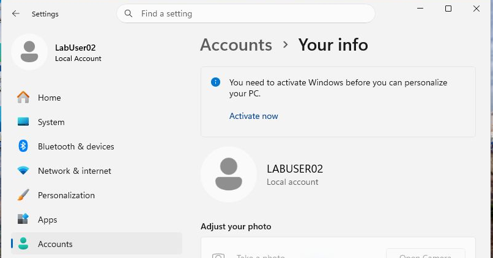
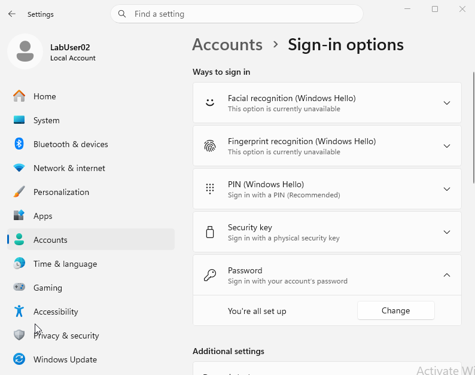
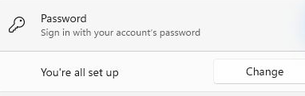

# Ticket 02: Windows Account Identification and Sign-In Verification

## Ticket Information
- **Category:** User Accounts / Authentication
- **Priority:** Low
- **Environment:** Windows 11 Home
- **Date:** November 11, 2026
- **Status:** Resolved

## Reported Issue
The user reports that their account is showing up as 'LabUser02' instead of displaying their email address. 
> The reported problem is a simulated scenario; no account issues are present in this ticket.

## Initial Assessment

The account listed does not establish if the user is signed in with a local account or Microsoft account. I checked the Windows Settings to see the account type and the sign-in options available.

## Troubleshooting Steps

### 1. Confirmed the signed-in account
After signing in, I opened the Start menu and checked the displayed account name.

> The Start menu displayed `LabUser02`.

### 2. Identified the Windows account type
I opened **Settings → Accounts → Your info**.

> Windows displayed **LABUSER02** as a **Local account**. This explained why the account appeared under a local username rather than a Microsoft account email address.

### 3. Reviewed the sign-in options
I opened **Settings → Accounts → Sign-in options**.

> The page listed Password, PIN (Windows Hello), security key, and biometric options. Face and fingerprint recognition were marked unavailable.
### 4. Checked the password configuration
I expanded the **Password** section.

**Result:**  
Windows displayed **“You’re all set up”** and a **Change** button.

> Windows displayed **“You’re all set up”** and a **Change** button. Windows indicated that a password was configured for the account.

## Resolution
I confirmed that `LabUser02` was a local Windows account. Its displayed a username but does not indicate an account fault.

For password sign-in, the user should select `LabUser02` and enter the password created for that local account. A Microsoft account email address and its password are separate credentials and do not replace the local account’s credentials.

Sign-in succeeded, and the desktop loaded under `LabUser02`. 

## Verification
| Check | Result |
|---|---|
| Signed-in account | LabUser02 displayed in Start and Settings |
| Account type | Local account |
| Password configuration | “You’re all set up” displayed |
| Manual sign-in | Successful |
| Desktop access | Confirmed |
| Corrective changes | None required after lab setup |

Verification covered a successful manual sign-in and the account information shown in Settings. No failed email-based sign-in was attempted, and no command-line account checks were performed.

## Prevention & Recommendations
- Check the account type before deciding which credentials to use.
- Explain the difference between a local account, a Microsoft account, and a Windows Hello PIN.
- Confirm the selected account and sign-in method before requesting a password reset.
- Use a standard account for routine activity and keep the administrator account separate.
- Keep passwords, PINs, and security-question answers out of documentation and screenshots.

## Evidence
The following screenshots supported the following:
- The loaded desktop and LabUser02 name in the Start menu
- The local account type shown under Your info
- The available sign-in options
- The configured password status

## Lessons Learned

A local Windows account can display a username instead of an email address. This is expected behaviour and does not automatically indicate a sign-in problem.

Checking the account type helps explain which credentials apply and avoids unnecessary password resets or account changes.
