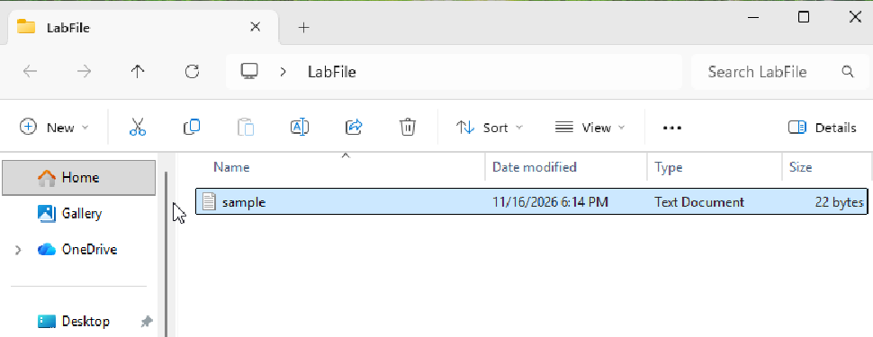
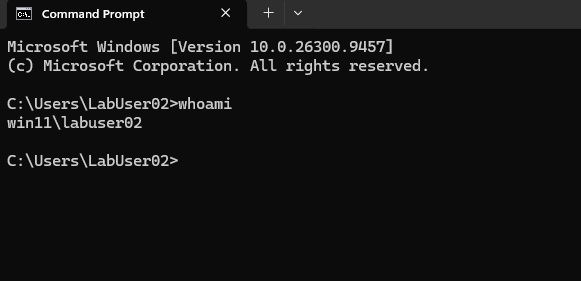
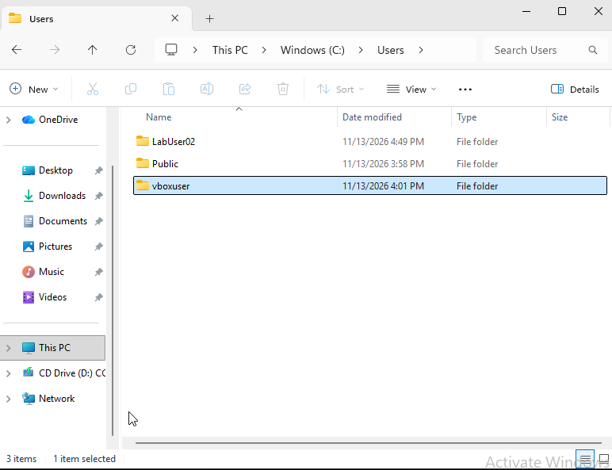
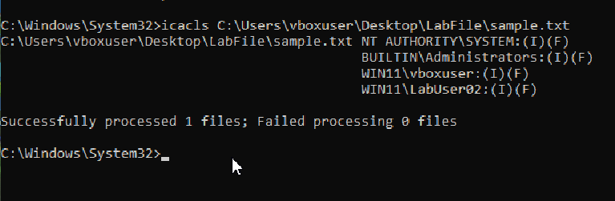

# Ticket 03: File Access and Permissions

## Ticket Information
- **Category:** File Permissions
- **Priority:** Low
- **Environment:** Windows 11 Home
- **Date:** November 11, 2026
- **Status:** Resolved

## Reported Issue
The user needed access 'sample.txt' in a folder belonging to another user but could not access it. 

## Initial Assessment
I checked to see if the folder and txt file existed in the owner's account. Both the folder, and 'sample.txt' file exist.

## Troubleshooting Steps
### 1. Confirmed the folder and file existed
While signed into the owner of the folder and file, I opened `LabsFile` and read `sample.txt`.


> The folder opened, and the sample file was readable. This confirmed that the folder and file existed and were accessible to the owner. It did not confirm that another account could access them.

### 2. Confirmed the test user’s identity
I signed in as another standard user and ran:
```whoami```


> The output identified the current account as `LabUser02` under the local computer’s name. This confirmed that I was testing access with the intended account rather than the folder owner or an administrator account.

### 3. Tested access before changing permissions
As `LabUser02`, I navigated to the test folder’s location and attempted to open the folder and read `sample.txt`.


> The test user could not access the sample file. The folder containing the test files required an administrative password.

### 4. Inspected the folder permissions
I returned to the folder owner’s account and opened:

**Folder Properties → Security → Advanced**

I reviewed the permission entries, their inheritance, and whether access was assigned directly or through a group. I also inspected the folder’s permissions using:

> icacls "C:\users\vboxuser\Desktop\LabFile\sample.txt"


> The permission review did not identify an applicable Allow entry that provided the test user with the required read access.

### 5. Granted the required read access

I added `LabUser02` to the test folder’s permissions and allowed:

- Read & execute
- List folder contents
- Read

I applied the entry to **this folder, subfolders, and files** and checked that `sample.txt` received the intended permissions.

I retained the existing owner, SYSTEM, and Administrators entries.

**Result:**  
The test account received read access to the folder and its contents.

### 6. Verified access using the test account

I returned to the `LabUser02` session and repeated the access test without running File Explorer or the text editor as administrator.

I opened the folder, read `sample.txt`, and attempted to create a new file in the same folder.

**Result:**  
The folder and sample file opened successfully. Creating a new file was denied.

**Analysis:**  
The test user could perform the required reading task while file creation remained restricted.

## Resolution
The test user initially could not access the sample file. I granted `LabUser02` read permissions on `PermissionLab` and its contents.

After the change, the test user could open the folder and read `sample.txt`. A separate attempt to create a file was denied.

The requested read access was restored without granting unnecessary write permissions or resetting the account’s password.

## Verification
| Test | Expected result | Observed result |
|---|---|---|
| Confirm the signed-in identity | LabUser02 | Confirmed |
| Open the test folder | Allowed | Successful |
| Open and read `sample.txt` | Allowed | Successful |
| Create a new file in the folder | Denied | Denied |

The verification covered folder access, reading, and file creation. Modification and deletion were not separately tested.

## Prevention & Recommendations
- Grant permissions according to the tasks the user needs to perform.
- Review existing entries, inheritance, and group membership before changing access.
- Use a dedicated shared folder for ongoing collaboration.
- Avoid granting Modify or Full control when read access is sufficient.
- Test access using the affected account without administrator privileges.
- Document the original access problem, the permission change, and the verification results.

## Evidence
The following screenshots supported the following:
- The `whoami` result identifying the test account
- The initial failed access attempt
- Relevant folder permissions before the change
- The read permission entry after the change, including its scope
- Successful access to `sample.txt`
- The denied attempt to create a file

## Lessons Learned
A file being readable by its owner does not mean that another user can access it. The affected account must be tested separately.

Access can come from permissions assigned directly to a user, group membership, or inheritance. Reviewing these sources helps avoid unnecessary permission changes.

Verification should include both an action that should succeed and an action that should remain restricted. In this lab, reading succeeded while creating a file remained blocked.
