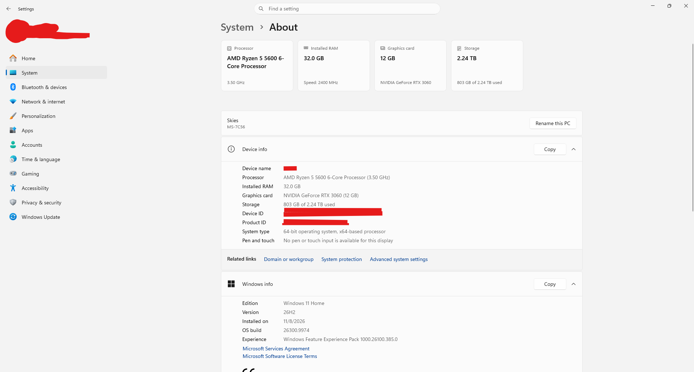
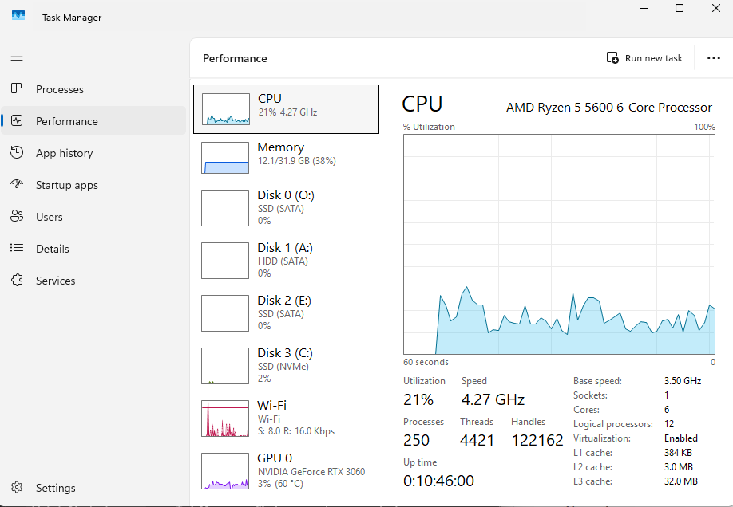
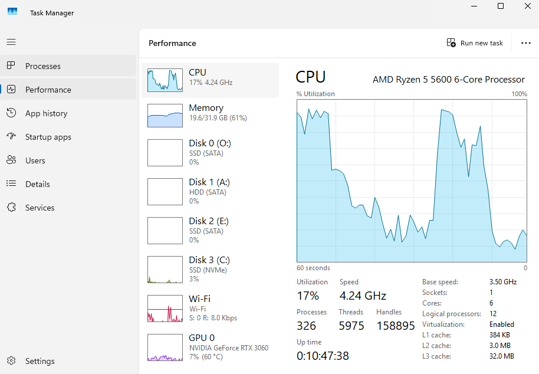
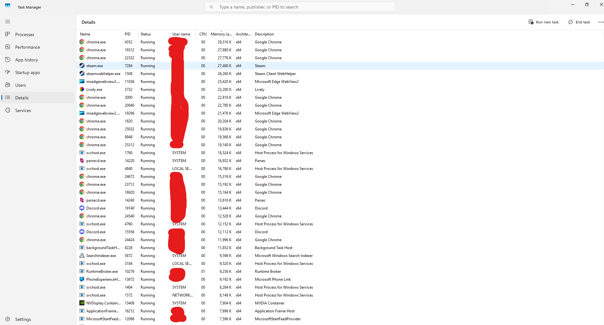
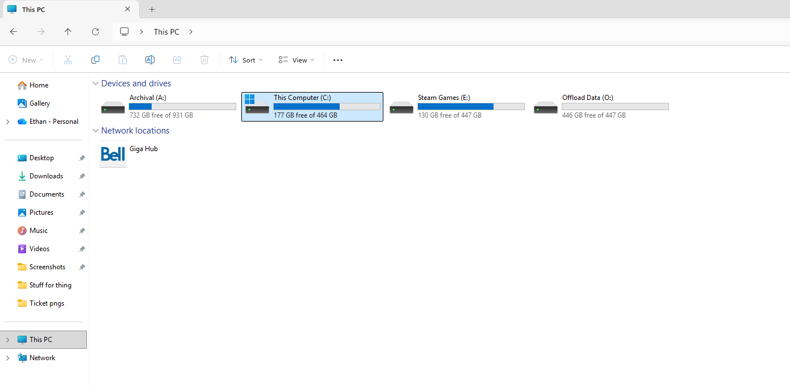
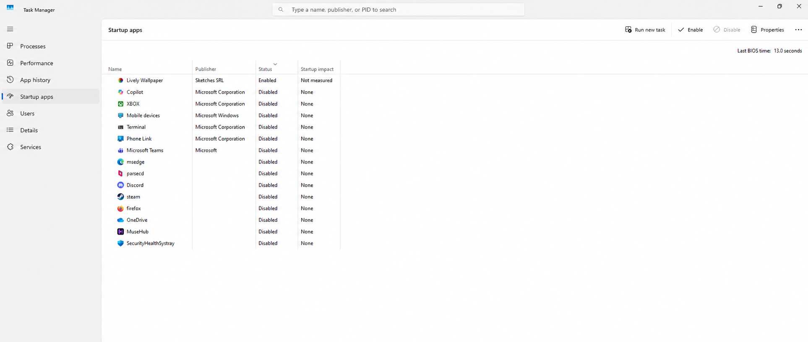
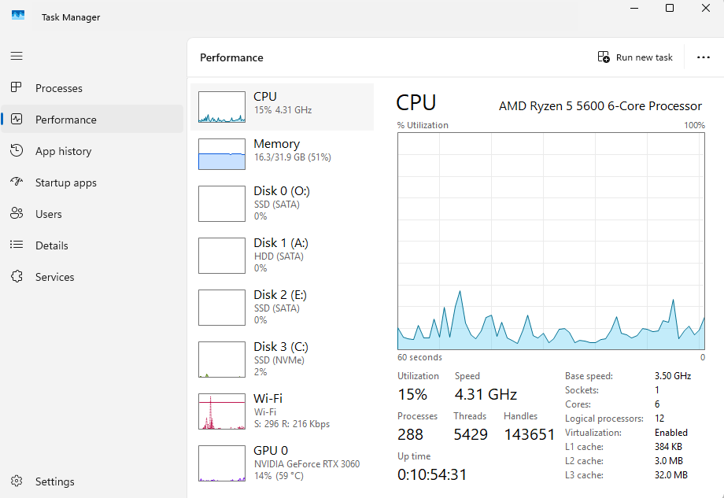

# Ticket 04: Slow Computer

## Ticket Information

- **Category:** Performance
- **Priority:** Low
- **Environment:** Windows 11 Home
- **Date:** November 11, 2026
- **Status:** Open

## Reported Issue

The user reports that the computer feels slow when opening applications and switching between tasks.

## Initial Assessment

I checked the computer’s specifications, CPU usage, memory usage, disk activity, available storage, and startup applications.

I compared three Task Manager captures to identify changes in resource usage. These measurements showed how system activity changed during the investigation, but did not include application launch times or a record of the exact workload at each capture.

## Troubleshooting Steps

### 1. Recorded the computer’s specifications

I checked Settings and Task Manager to identify the hardware and operating system.

| Component | Specification |
|---|---|
| Operating system | Windows 11 Home |
| Processor | AMD Ryzen 5 5600 6-Core Processor |
| CPU cores / logical processors | 6 cores / 12 logical processors |
| Installed RAM | 32 GB; Task Manager reports 31.9 GB usable |
| Graphics card | NVIDIA GeForce RTX 3060, 12 GB |
| System drive | NVMe SSD, C: |
| System drive capacity | 464 GB |

**Analysis:**  
These specifications provided context for the resource measurements. The hardware specifications alone did not identify the cause of the reported slowdown.

### 2. Recorded initial resource usage

I captured the Performance tab in Task Manager as an initial reference.

| Measurement | Initial reading |
|---|---|
| CPU usage | 21% |
| Memory usage | 12.1 / 31.9 GB -38% |
| System disk active time | 2% |
| Process count | 250 |

**Analysis:**  
At the moment of capture, overall CPU usage, memory usage, and system disk activity were below full utilisation. The visible CPU history fluctuated without remaining near 100%.

This was an initial reference reading rather than a confirmed idle baseline, since the exact applications and background tasks running at the time were not recorded.

### 3. Compared resource usage in the second capture

I reviewed a second Task Manager capture to compare system activity.

| Measurement | Second reading |
|---|---|
| CPU usage | 17% |
| Memory usage | 19.6 / 31.9 GB -61% |
| System disk active time | 3% |
| Process count | 326 |

**Analysis:**  
Memory usage increased by 7.5 GB, and the process count increased from 250 to 326.

Although the current CPU reading was 17%, the preceding 60-second graph showed periods of much higher activity, with peaks around 90%. This showed why the current percentage alone was not enough to describe the workload.

The CPU activity could be relevant to the reported slowdown, but the screenshot did not identify the responsible process or establish whether the spikes occurred at the same time as the symptoms. Memory was not fully used, and system disk active time was low at the moment of capture.

### 4. Reviewed running processes

I checked the Details tab in Task Manager.

Visible processes included:

- Google Chrome
- Steam and Steam Client WebHelper
- Microsoft Edge WebView2
- Lively
- Parsec
- Discord
- Windows services and background processes

**Analysis:**  
Several applications and background processes were running. However, the screenshot showed only part of the process list and did not identify which application was responsible for the earlier CPU spikes.

The presence of multiple Chrome or other application processes was not enough to establish a fault. A process-level capture taken during the slowdown would be needed to investigate further.

### 5. Checked available storage

I checked the drives in File Explorer.

| Drive | Available space | Total capacity |
|---|---|---|
| C: -System drive | 177 GB | 464 GB |
| A: -Archival | 732 GB | 931 GB |
| E: -Steam Games | 130 GB | 447 GB |
| O: -Offload Data | 446 GB | 447 GB |

**Analysis:**  
The system drive had approximately 38% of its capacity available. These readings did not support insufficient free storage as the cause of the reported slowdown.

Available storage and disk activity are separate measurements. Having free space does not, by itself, establish disk health or rule out every storage-related issue.

### 6. Reviewed startup applications

I checked the Startup apps section in Task Manager.

Lively Wallpaper was shown as enabled, with its startup impact listed as Not measured. The other visible entries were shown as disabled.

**Analysis:**  
The screenshot recorded the startup configuration at the time of the review. It did not show when the entries were disabled or establish that startup settings had been changed as part of this investigation.

Lively Wallpaper’s enabled status did not prove that it caused the slowdown. No startup-related cause was confirmed.

### 7. Compared the final resource reading

I reviewed the final Task Manager capture.

| Measurement | Final reading |
|---|---|
| CPU usage | 15% |
| Memory usage | 16.3 / 31.9 GB -51% |
| System disk active time | 2% |
| Process count | 288 |

**Analysis:**  
Compared with the second capture, memory usage decreased by 3.3 GB and the process count decreased by 38. The final CPU graph also showed less activity than the second capture.

These readings showed a reduction in resource usage, but the specific action or workload change between captures was not recorded. Lower resource usage alone did not confirm that application responsiveness had improved.

## Resolution

The investigation recorded temporary periods of high CPU activity and an increase in memory usage, followed by lower usage in the final capture.

The system drive had sufficient free space, and the screenshots did not show memory exhaustion or sustained high system disk activity. However, they did not identify a specific application as the cause of the reported slowdown.

No corrective action or successful responsiveness test was documented. The ticket remains open until the slowdown can be linked to a cause or the user confirms that the issue is no longer occurring.

## Verification

| Measurement | Initial capture | Second capture | Final capture |
|---|---|---|---|
| CPU usage at capture | 21% | 17% | 15% |
| Memory usage | 12.1 GB -38% | 19.6 GB -61% | 16.3 GB -51% |
| System disk active time | 2% | 3% | 2% |
| Process count | 250 | 326 | 288 |
| Application opening and task-switching performance | Not measured | Not measured | Not measured |

The readings confirm that resource usage changed during testing. They do not establish a controlled before-and-after comparison or verify a repair.

## Prevention & Recommendations

- Repeat the application-opening and task-switching test while recording which applications are open.
- Capture Task Manager’s Processes tab during the slowdown, sorting by CPU, Memory, and Disk separately.
- Save work before closing an unused application, then repeat the same test to check whether responsiveness improves.
- Change one setting at a time so that its effect can be assessed.
- Review optional startup applications without assuming that an enabled entry is causing a performance problem.
- Record the action taken and the result before marking the ticket resolved.

## Evidence

The screenshots document:

- Computer specifications
- Initial resource usage
- A second capture showing higher memory usage and earlier CPU spikes
- A partial list of running processes
- Available drive space
- Startup application settings
- Final resource usage

## Lessons Learned

The current CPU percentage does not show everything that happened during the preceding minute. In the second capture, CPU usage was 17% at the moment of the screenshot, but the graph showed much higher activity shortly beforehand.

An increase in memory usage or process count does not automatically identify a problem. The readings need to be compared with the actual symptoms and the applications running at the time.

Lower resource usage in a later screenshot is not enough to prove that a repair worked. A complete resolution requires a documented action and a repeat test showing that the reported problem has improved or stopped.
