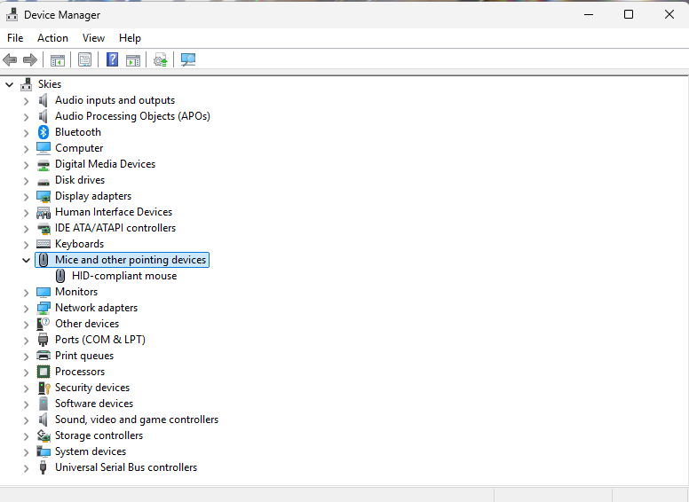
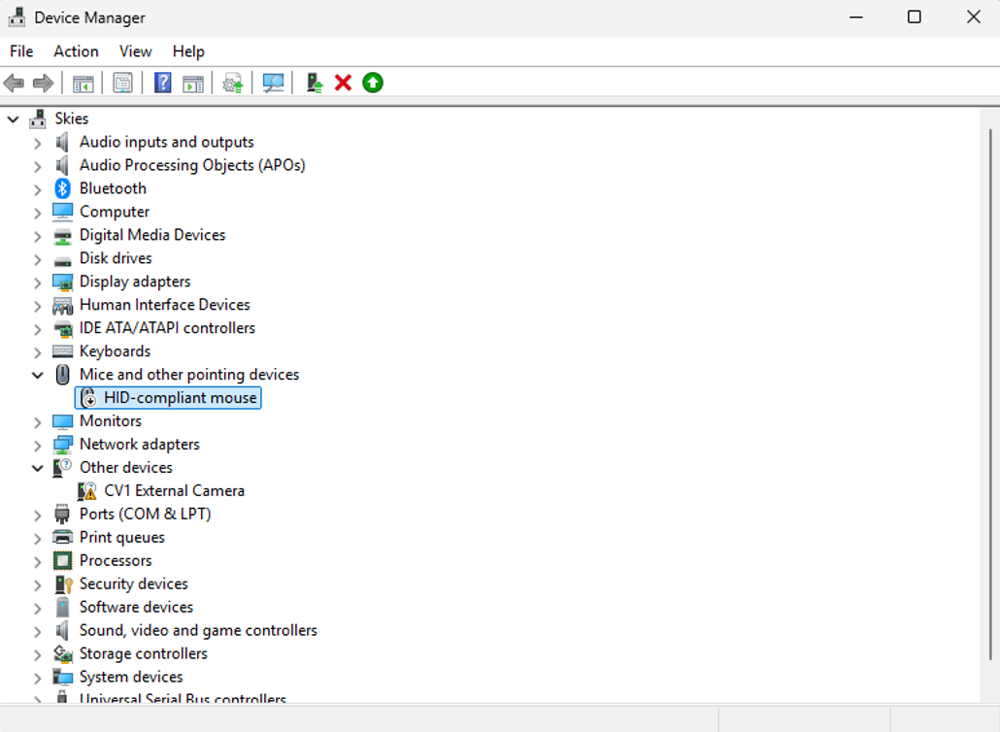
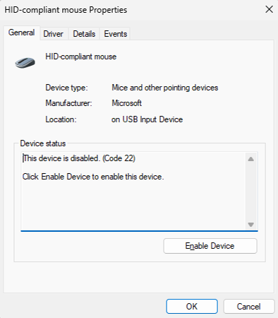
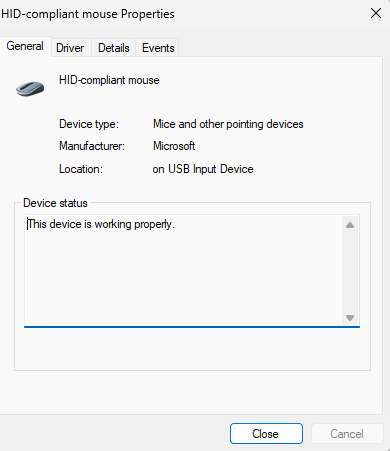

# Ticket 05: Driver or Device Issue

## Ticket Information

- **Category:** Windows / Devices and Drivers
- **Priority:** Low
- **Environment:** Windows 11
- **Date:** 11/11/2026
- **Status:** Resolved

## Reported Issue

In this simulated scenario, a connected mouse is unavailable because it has been disabled in Device Manager.

> The disabled state was deliberately introduced for this lab to practise checking device status and restoring the device.

## Initial Assessment

I located the mouse in Device Manager and checked its properties to determine why it was unavailable.

The device was listed as **HID-compliant mouse** under **Mice and other pointing devices**. I reviewed its status before deciding whether a driver change was necessary.

## Troubleshooting Steps

### 1. Located the mouse in Device Manager

I opened Device Manager and expanded **Mice and other pointing devices**.

**Result:**  
Windows listed the device as HID-compliant mouse.

**Analysis:**  
The mouse had an entry in Device Manager. I continued by inspecting its state and properties rather than assuming that it needed a new driver.

### 2. Examined the disabled device

I reviewed the mouse entry after disabling it for the lab.

**Result:**  
The mouse entry displayed the disabled-device indicator.

**Analysis:**  
The indicator showed that the device was disabled. I opened its properties to read the exact status message.

### 3. Checked the device status

I opened **Properties > General**.

**Result:**  
The Device status box reported:

“This device is disabled. (Code 22)”

It also instructed me to enable the device.

**Analysis:**  
The status identified the disabled state as the issue. The appropriate next step was to enable the device rather than update or reinstall its driver.

### 4. Reviewed the device information

I checked the information shown in the General and Details tabs.

| Property | Recorded value |
|---|---|
| Device description | HID-compliant mouse |
| Device type | Mice and other pointing devices |
| Manufacturer shown in Windows | Microsoft |
| Location | on USB Input Device |

**Analysis:**  
These properties documented how Windows identified the device.

The Details tab showed the device description. It did not show the driver provider, date, or version, so those values were not recorded in this ticket.

### 5. Enabled the mouse and checked its status

I enabled the mouse and reopened **Properties > General**.

**Result:**  
The Device status box reported:

“This device is working properly.”

**Analysis:**  
The Code 22 message was cleared, and Windows reported a working device state. No driver replacement was needed to clear the disabled status.

## Resolution

The HID-compliant mouse had been deliberately disabled for the lab. Device Manager identified this with Code 22.

I enabled the device and confirmed that its status changed to “This device is working properly.” The simulated disabled-device issue was resolved.

The documented verification confirms the status change in Device Manager. Separate results for pointer movement, clicking, scrolling, and reconnection were not recorded.

## Verification

| Check | Before enabling | After enabling |
|---|---|---|
| Device entry | HID-compliant mouse listed | HID-compliant mouse listed |
| Device status | Disabled — Code 22 | This device is working properly |
| Disabled-state error | Present | Cleared |
| Pointer movement, clicking, and scrolling | Not documented | Not documented |

## Prevention & Recommendations

- Identify the correct device before changing its settings.
- Read the device status and error code before deciding whether a driver change is needed.
- Keep an alternative way to control the computer available when testing an input device.
- Avoid updating or reinstalling drivers when enabling the device addresses the identified issue.
- After restoring the device, test its normal functions as well as checking Device Manager.
- Record driver information from the Driver tab when investigating a suspected driver problem.

## Evidence

The screenshots document:

- The HID-compliant mouse entry in Device Manager
- The disabled-device indicator
- The Code 22 status message
- The device description in the Details tab
- The working status after enabling the device

A separate warning is visible for **CV1 External Camera** in one screenshot. That device was outside the scope of this mouse troubleshooting lab and was not investigated.

## Lessons Learned

A device can appear in Device Manager but still be unavailable because it is disabled.

Reading the exact status message helped identify the issue and select a relevant action without making unnecessary driver changes.

The Details and Driver tabs provide different information. A device description does not establish the installed driver version.

Device Manager’s working status confirms that the disabled-state error has cleared. Testing the mouse directly is also needed to verify its normal functions.
